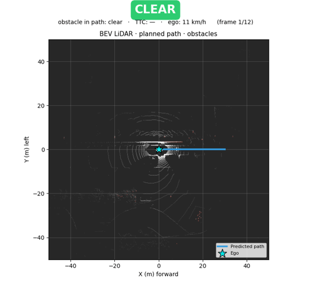
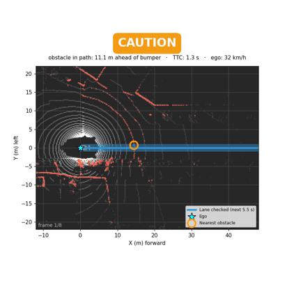
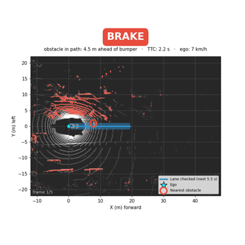
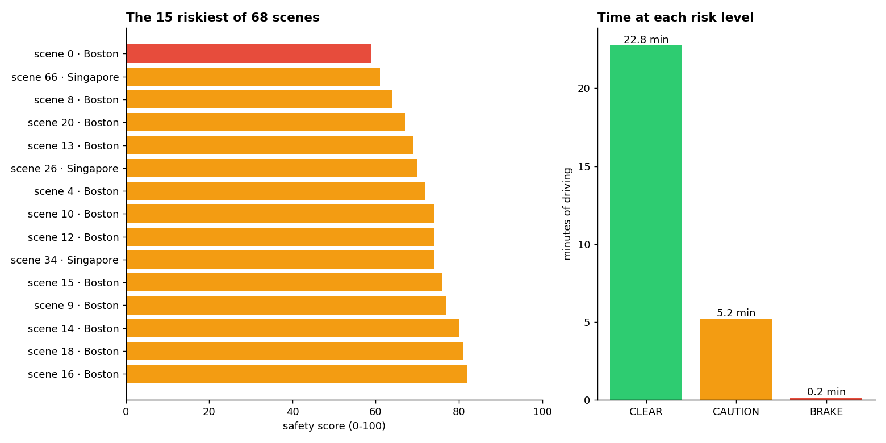
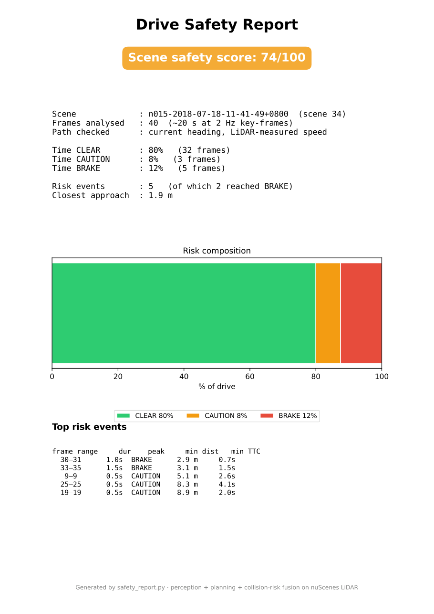
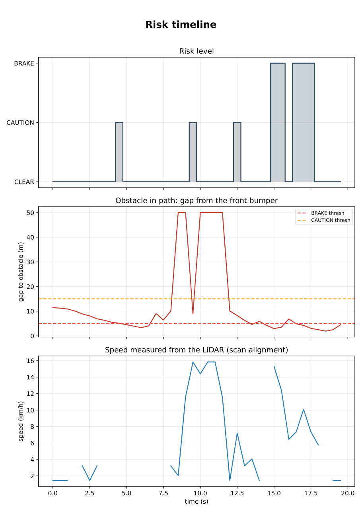

# Driving-risk review on nuScenes: LiDAR trajectory prediction, collision risk, fleet safety scoring


**The business question.** Fleets and insurers record hours of driving and can't watch it all.
*Which moments should a safety manager actually look at, and how risky was each drive?*

**What this repo gives back.** Every drive gets a 0–100 safety score, and only the close calls
(an obstacle in the car's lane, under 5 m from the bumper, while moving) go into a review queue.
On 28 minutes of real nuScenes driving (Boston and Singapore), that queue is
**9 moments, 0.6 minutes of footage, 2% of the recording.**

<p align="center">
  
  
  
</p>
<p align="center"><em>Real LiDAR scans, top-down: the blue lane is where the car will be in the next 5.5 s. CLEAR · CAUTION · BRAKE.</em></p>

▶️ **[Watch the 45-second walkthrough](demo/demo.mp4)**: the question, the answer, one real drive, the evidence, how it's built.

---

## In plain words

1. **See.** Each LiDAR scan becomes a top-down map of the car's surroundings (100 m × 100 m).
   The car's speed is measured by aligning consecutive scans: no model, no guesswork.
2. **Check the lane ahead.** The lane the car will cover in the next 5.5 seconds is searched for
   anything at least 0.5 m tall. First obstacle less than 5 m from the front bumper: **BRAKE**;
   under 15 m: **CAUTION**; otherwise **CLEAR**, with the gap and the time to reach it.
3. **Review.** Over a whole recording, every drive is scored and every BRAKE moment *while moving*
   (not at a red light) is queued for a human, worst first, with a plain-language note written by
   a local language model.
4. **Learn.** Two models trained on 200 GB of nuScenes on AWS SageMaker: a bird's-eye-view network
   that predicts the car's next 5.5 s as three candidate paths, and a YOLOv8 camera detector. The
   planner is evaluated against the car's real motion before it is trusted (below).

## Who would use the output

| User | Question they have | What they get here |
|---|---|---|
| Fleet safety manager | Which clips do I watch, which drivers do I coach? | `fleet_review.py`: ranked BRAKE moments, minutes of footage to review, per-drive score |
| Usage-based insurer | How risky is this vehicle's driving? | per-drive safety score and time at each risk level |
| AV / ADAS data team | Where are the hard scenes in our logs? | risk timeline per scene, multi-modal paths, near-miss list |
| ADAS engineer | Is there something in my path, and how soon? | per-frame CLEAR / CAUTION / BRAKE with distance and time-to-collision |

## Results on real data



| Fleet review (all local data) | Value |
|---|---|
| Driving analysed | 28 min: 3,376 LiDAR key-frames, 68 scenes, Boston and Singapore |
| Time at each risk level (moving) | CLEAR 22.8 min · CAUTION 5.2 min · BRAKE 0.2 min |
| Close calls queued (BRAKE while moving) | 9, in 6 of 68 scenes |
| Footage left to watch (2 s lead-in each) | 0.6 min, 2% of the recording, worst first |

| Trained models | Value | What it means |
|---|---|---|
| Trajectory planner, validation ADE / FDE | 3.29 m / 7.23 m | average / final position error over a 5.5 s horizon, epoch-5 checkpoint |
| YOLOv8n detector, precision / recall | 0.64 / 0.30 | one generic "object" class, 20 epochs on CPU, still improving when stopped |
| YOLOv8n detector, mAP@0.50 / @0.50–0.95 | 0.35 / 0.21 | rose every epoch (0.04 → 0.35): compute-limited, not converged |

**Is the learned planner good enough to drive the risk check?** `planner_eval.py` compares its
position 3 s ahead with the car's real motion, recovered from the LiDAR (97 moving frames):

| 3 s ahead | mean absolute error |
|---|---|
| Sideways, learned planner (epoch 5) | 0.91 m |
| Sideways, 'keeps its heading' baseline | 0.10 m |
| Forward distance, learned planner | 17.3 m (real median 12.8 m, planner median 30.7 m) |

Not yet: its sideways prediction is worse than "keep the heading" (correlation -0.10). The cause
is a training bug found in the audit (the mirror augmentation flipped the forward axis), so the risk
check follows the measured heading until the planner is retrained.

Every number comes from the training logs, the checkpoint metadata, `fleet_review.py` or
`planner_eval.py` output in this repo. The detector was trained on a laptop CPU; both models are
listed under "What's next".

<p align="center">
  
  
</p>
<p align="center"><em>The per-drive safety report for the demo scene (<code>safety_report.py</code>).</em></p>

---

## How it works

```
   LIDAR_TOP scans ─► BEV rasters ─┬─► obstacle map (≥ 0.5 m tall) ─────────────────┐
   (.pcd.bin, 2 Hz)   500×500×3    ├─► LiDAR odometry (scan alignment) ─► speed ─► lane ahead (5.5 s)
                                   │                                                 ▼
                                   │                      risk layer ─► CLEAR / CAUTION / BRAKE + gap, TTC
                                   │                                                 ▼
                                   │      safety_report.py (one drive) · fleet_review.py (review queue)
                                   │                                                 ▼
                                   │                local language model (Ollama) ─► review notes
                                   │
                                   └─► BEV planner (PyTorch) ─► 3 paths ─► planner_eval.py vs real motion
   CAM_FRONT images ─► YOLOv8 detector ─► named boxes (alongside; not yet fused)
```

- **Data pipeline** (`data_preparation_v2.py`): parses the nuScenes tables, builds the ground-truth
  future path in the car's own frame (`p_ego = R⁻¹ · (p_world − t)`), and rasterises each LiDAR
  sweep into height / intensity / density channels at 0.2 m per cell.
- **Planner** (`trajectory_model.py`, `train_trajectory_v3.py`): VGG-style encoder → 256-d embedding
  → 3 trajectory heads, a mode-probability head and a per-waypoint confidence head (~12 M parameters).
  Trained with a winner-takes-all Huber loss, a mode-classification loss and a diversity term
  against "always go straight", with rotation and mirror augmentation (the mirror flipped the wrong
  axis; fixed for the next run).
- **Risk layer** (`collision_risk.py`, pure NumPy): converts the lane from the car's frame
  (x forward) into the LiDAR's frame (y forward), walks it outward from the front bumper inside a
  vehicle-wide corridor and stops at the first obstacle cell. TTC = gap / speed. Gaps while the
  car is stopped or crawling under 7 km/h don't count as close calls.
- **LiDAR odometry** (`collision_risk.lidar_odometry`): the car's speed comes from aligning two
  consecutive scans with an FFT cross-correlation; the peak is how far the world moved.
- **Planner evaluation** (`planner_eval.py`): compares the planner's position 3 s ahead with the
  car's real motion, recovered the same way. That test is why the lane follows the measured heading
  for now: see the table above and the technical report.
- **Detector**: YOLOv8n fine-tuned on 20,256 nuScenes frames, or the stock COCO model filtered to
  road classes for named boxes.
- **Language layer** (`vlm_reasoner.py`): a local Ollama model turns the measured numbers into a
  plain-language note and a spoken driver instruction. Run live with `qwen3:8b` (text). The vision
  path (six cameras + the LiDAR view to Qwen2.5-VL) is built and tested against a stub; running it
  for real needs a time-synchronised camera set, see the [technical report](docs/Technical_Report.md#10-vlm-reasoning-layer-vlm_reasonerpy-vlm_analyzepy).
- **Recovering a lost model**: the planner's class definition was lost with the SageMaker
  instance. It was rebuilt from the 146 MB checkpoint alone and verified to load all 130 weight
  tensors exactly (`load_state_dict(strict=True)`).

Full details, formulas and known issues: **[docs/Technical_Report.md](docs/Technical_Report.md)**.

---

## Run it

```bash
pip install -r requirements.txt               # CPU is enough for inference
# put nuScenes LIDAR_TOP key-frames (*.pcd.bin) in ./LIDAR_TOP (the free mini split works)

python fleet_review.py                        # all drives -> scores, review queue, chart
python planner_eval.py                        # learned planner vs the car's real motion
python fleet_review.py --from-csv --notes qwen3:8b   # + review notes from a local Ollama model
python safety_report.py --scene 3             # one drive -> PDF safety report
python risk_monitor.py                        # annotated risk video over a sequence
python demo/make_demo.py                      # rebuild every GIF, image and the walkthrough video
streamlit run app.py                          # interactive app: detection, trajectory, dashboard
python trajectory_model.py                    # sanity check: weights load with strict=True
```

Weights are tracked with Git LFS. nuScenes data is downloaded separately from nuscenes.org.

## Repo map

```
fleet_review.py        all drives -> per-drive score, ranked BRAKE moments, review time, notes
planner_eval.py        learned planner vs real motion recovered from the LiDAR
safety_report.py       one drive -> PDF safety report
collision_risk.py      frames, obstacle map, LiDAR odometry, lane check -> CLEAR / CAUTION / BRAKE
trajectory_model.py    BEV planner architecture (encoder + heads)
train_trajectory_v3.py planner training (augmentation, diversity loss)
data_preparation_v2.py nuScenes -> BEV rasters + ground-truth future paths
risk_monitor.py        sequence -> annotated risk video
scene_dashboard.py     scene splitting, timestamp sync, dashboard frames
vlm_reasoner.py        language / vision-language layer (Ollama backend, prompts, JSON parsing)
vlm_analyze.py         surround cameras + BEV -> reasoning card
scene_narrator.py      per-scene narration (needs a vision model and synced cameras)
app.py                 Streamlit app
run_inference.py       batch inference (yolo, named, bev)
demo/make_demo.py      rebuilds the demo GIFs, report images and walkthrough video
docs/                  technical report
```

## What's next

1. Retrain the planner with the fixes listed in the technical report (mirror the lateral axis, logits
   in the mode loss, a scene-level validation split), then switch the lane check to the learned path
   once `planner_eval.py` shows it beats the heading baseline.
2. Train the detector multi-class on a GPU and project its boxes into the BEV once the camera
   calibration is wired in, so both sensors feed one obstacle map.
3. Track obstacles over time so TTC uses the closing speed, not only the car's own speed.
4. Run the vision-language path on synchronised cameras and score its hazard calls against nuScenes
   labels (construction zones, emergency vehicles, pedestrians).
5. Latency profiling and ONNX/TensorRT export for an embedded target.

## Changelog

- **November 2026 review** (details in the [technical report](docs/Technical_Report.md#85-corrections-made-in-november-2026)).
  - The risk layer looked up the path in the LiDAR raster without converting frames, so it searched
    to the right of the car instead of ahead. It now converts frames, checked against the data.
  - The obstacle height test only counted things more than about 2.1 m above the road, so most cars
    and pedestrians were missed. It is now 0.5 m above the road.
  - The planner was evaluated against the car's real motion: its sideways prediction is worse than
    "keep the heading", traced to the mirror augmentation flipping the forward axis. The risk check
    now follows the measured heading, and speed is measured from the LiDAR instead of inferred.
  - Close gaps while stopped or crawling (lights, queues) no longer count as close calls.
  - Speed and time-to-collision used a 10 s horizon instead of the 5.5 s the planner was trained on.
  - Distances are now gaps from the front bumper, and the car's own LiDAR returns are masked.
  - Scene splitting merged two recordings.
  - Added `fleet_review.py`, per-scene safety reports and `demo/make_demo.py`. Every demo is rebuilt
    from the model's predicted path. Demo clips produced by the offline stub instead of a real
    model were removed.
  - The BEV rasteriser is vectorised (about 17× faster, bit-identical output).
