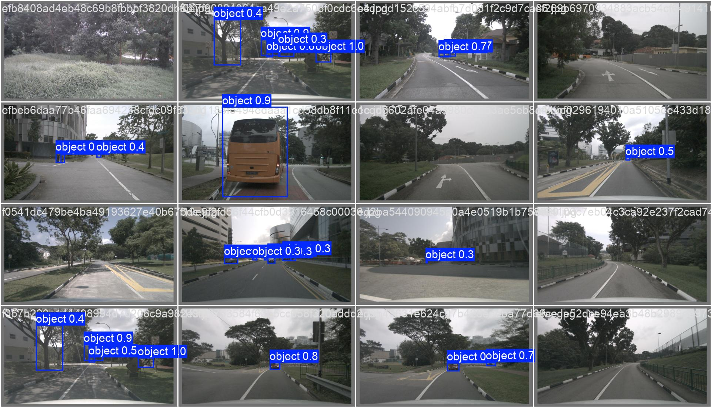
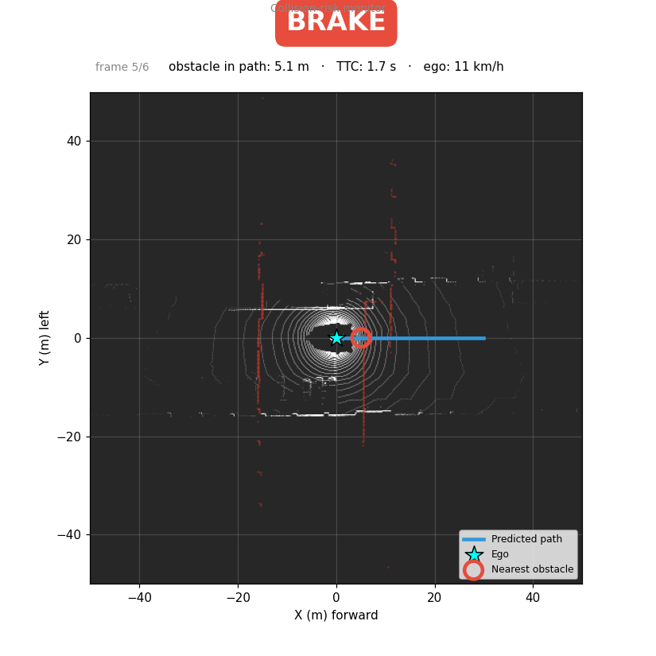
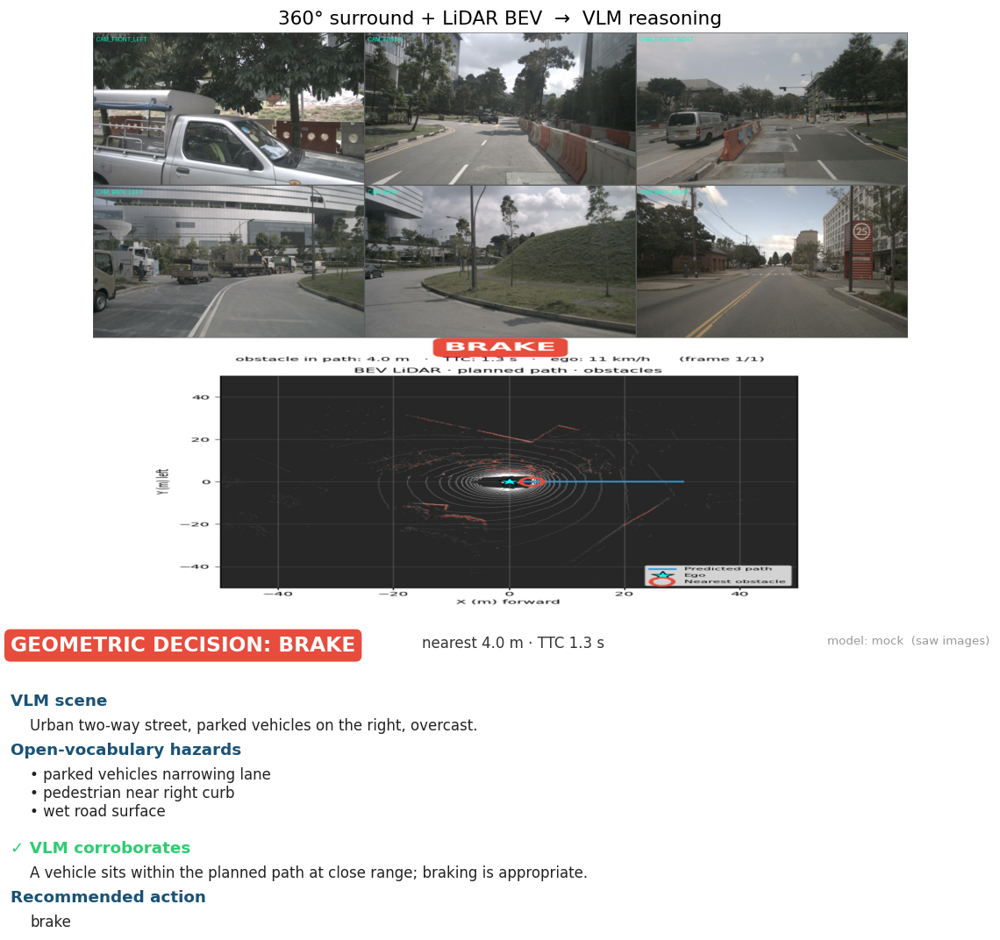
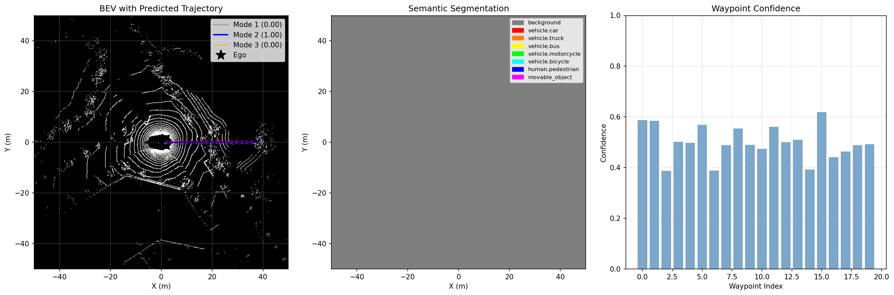
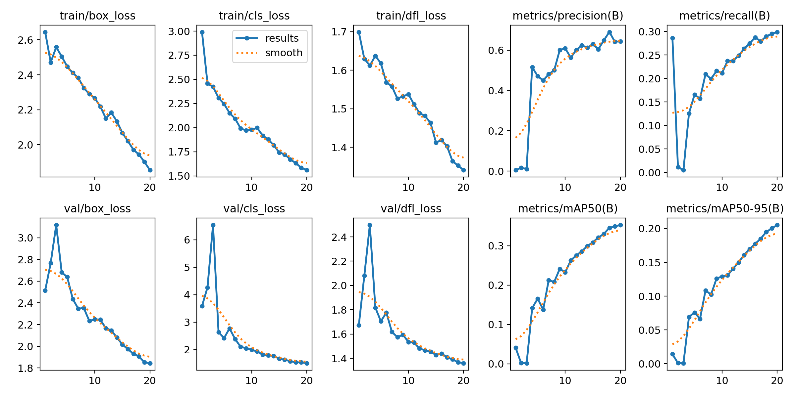
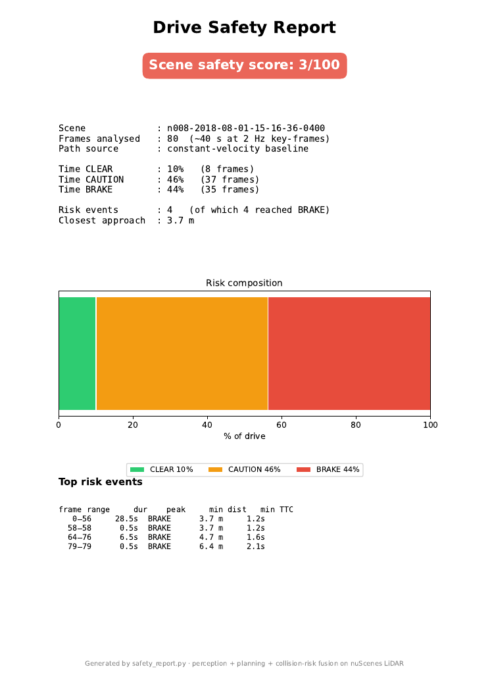

# 🚗 Autonomous Perception & Planning for ADAS — YOLO + BEV on nuScenes


> A two-stage self-driving perception stack that **sees the road, predicts where the car is going, and decides whether to brake** — trained on the nuScenes dataset on AWS SageMaker, and packaged as an interactive demo you can run locally.

<p align="center">
  
  
  
</p>
<p align="center"><em>Live collision-risk monitor — the same pipeline, three outcomes: CLEAR · CAUTION · BRAKE.</em></p>

## ▶️ Demo

The three GIFs above are the live collision-risk monitor. The panels below are captured from the Streamlit app; the narrated scene clips live in [`demo/scenes/`](demo/scenes/).

### Screenshots

| Detection | BEV trajectory | Scene dashboard | VLM co-pilot |
|---|---|---|---|
|  |  |  |  |

_(screenshots live in [`demo/screenshots/`](demo/screenshots/); the narrated scene clips are in [`demo/scenes/`](demo/scenes/))_

---

## What this is

Forward-collision warning and automatic emergency braking sit at the core of every modern driver-assistance (ADAS) and autonomy product. The capability behind them is always the same loop: **perceive the scene → predict the path → flag the conflict.** That loop usually spans two specialist teams. This project is one engineer owning the whole slice, end to end:

- **Perception** — a YOLOv8 detector finds obstacles (vehicles, pedestrians, cyclists) in the camera feed.
- **Planning** — a custom bird's-eye-view (BEV) network predicts the ego vehicle's short-horizon trajectory from LiDAR, with several weighted hypotheses.
- **Decision** — a fusion layer projects the predicted path against the LiDAR obstacle map and emits a **CLEAR / CAUTION / BRAKE** signal with distance-to-obstacle and time-to-obstacle (TTC).

The result runs three ways: a live **Streamlit demo**, a **collision-risk video monitor** over a driving scene, and a per-scene **PDF safety report**.

📄 **Full technical write-up:** [`Technical_Report.pdf`](Technical_Report.pdf) — architecture, algorithms, math, and business analysis in depth.
🎬 **Demo walkthrough:** see [`demo/`](demo/) (narrated screen recording of the app).

---

## Why it matters (the business case)

A fused *detect-and-predict-and-decide* module is the input to three different products, and **the same code path serves all of them — only the consumer of the output changes:**

| Market | What they consume | Output used |
|---|---|---|
| **ADAS / OEM** | real-time warn & brake | CLEAR/CAUTION/BRAKE + TTC, per frame |
| **Fleet & usage-based insurance** | per-drive risk score | risk timeline + near-miss events (the PDF report) |
| **AV research / validation** | scene triage & labelling | multi-modal trajectories + risk profile |

Distance-to-obstacle and time-to-obstacle are the quantities every one of these is ultimately built on. That is the value this project demonstrates — not a leaderboard number, but a correct, runnable pipeline that produces a *decision*.

---

## System architecture

```
   ┌──────────────┐   camera    ┌─────────────────┐  boxes
   │  CAM_FRONT    ├────────────►│  YOLOv8 detector ├───────────┐
   └──────────────┘             └─────────────────┘  (named)    │
                                                                 ▼
                                                        ┌──────────────────┐
   ┌──────────────┐  LiDAR BEV  ┌─────────────────┐    │  collision-risk   │  CLEAR
   │  LIDAR_TOP    ├────────────►│  BEV planner net ├───►│  fusion           ├─ CAUTION
   │  (.pcd.bin)   │  500×500×3  │  (multi-modal)   │    │  path × obstacles │  BRAKE
   └──────────────┘             └─────────────────┘    └──────────────────┘  + dist/TTC
                                  3 paths · mode probs
                                  · per-waypoint conf
```

**Two complementary sensors, two models, one decision surface.** The camera answers *what is ahead*; the LiDAR planner answers *where am I going*; the fusion layer answers *is that a problem*.

---

## The two models

### 1 · YOLOv8 obstacle detector
Fine-tuned on **20,256** nuScenes camera frames. The training run used a single `object` class (so the warning logic is "anything with enough confidence is something to avoid"); the app also offers a stock **COCO-pretrained YOLOv8** filtered to road classes (`person, bicycle, car, motorcycle, bus, truck`) for **named** detection with zero extra training.


### 2 · BEV multi-modal trajectory planner
A VGG-style encoder turns a **500×500×3** LiDAR bird's-eye raster (height / intensity / density) into a 256-d scene embedding shared by four heads: **3 candidate trajectories** (20 waypoints each), a **mode probability**, a **per-waypoint confidence**, and an auxiliary **8-class BEV segmentation** head. Multi-modality matters because at an intersection the "correct" future isn't unique — a safety layer must weigh several.



---

## 🧠 VLM reasoning layer (open-vocabulary, neuro-symbolic)

The geometric stack is precise but **closed-vocabulary**: it measures *where* obstacles are, not *what they mean*. A local **Vision-Language Model** (Qwen2.5-VL via [Ollama](https://ollama.com)) adds the missing semantic layer. Crucially it reasons over the **full 6-camera surround view and the LiDAR BEV at once** — not just the front camera a driver already sees — and returns:

- an **open-vocabulary hazard list** the detector structurally cannot produce — construction zones, emergency vehicles, traffic-light state, road debris, animals, vulnerable road users, weather/road-surface conditions;
- a one-line **scene caption**;
- a **corroboration** of the CLEAR / CAUTION / BRAKE decision with a natural-language **rationale** — an independent second channel that can catch what a LiDAR-only risk layer misses;
- a **recommended action**.

A VLM can't read raw point clouds, so the LiDAR is handed to it as the rendered **BEV image** alongside the six cameras — it reasons over all seven views jointly. This turns a classical perception/planning stack into a **neuro-symbolic** system: geometry for precise *measurement*, language for *meaning* and *explanation*.


### Narrated scene demo (`scene_narrator.py`)

The headline VLM demo: pick **4–5 scenes** (auto-split from the LiDAR stream by timestamp and chosen for risk variety) and have the VLM **narrate each scene as it unfolds** — reasoning across all 6 camera angles *and* the LiDAR BEV over the scene's ~20 frames. It emits a live "co-pilot" comment per segment plus a holistic scene summary, rendered as a subtitled clip (GIF + MP4) with a text transcript per scene.

```bash
ollama pull qwen2.5vl:7b
python scene_narrator.py --cam-dir <nuscenes_cams> --scenes 5 --model qwen2.5vl:7b
# offline structure check (no GPU/server):  python scene_narrator.py --backend mock --scenes 3
```

Outputs land in [`demo/scenes/`](demo/scenes/) (one GIF + MP4 + transcript per scene, plus an index).

Also available as a **Streamlit tab** ("VLM scene reasoning") that lists your local Ollama models and runs live in the app — a vision model (e.g. `qwen3-vl`) sees the surround + BEV, while text-only models (`qwen3:8b`, `phi3.5`) reason over the perception summary. The app shows a badge for which mode is active.

> Runs fully locally via Ollama — `ollama pull qwen2.5vl:7b`. The backend is pluggable: `qwen3:8b` also works but is **text-only** (it reasons over the structured perception summary without seeing the images — use a `*-vl` model for true vision). `--backend mock` runs the entire pipeline with no GPU or server, for development.

---

## Data pipeline — from 200 GB on AWS SageMaker to local inference

The model was developed on an **AWS SageMaker** notebook instance against the full ~200 GB [nuScenes](https://www.nuscenes.org/) dataset. The pipeline (`data_preparation_v2.py`):

1. **Parse nuScenes metadata** — link each `sample` to its `LIDAR_TOP` sweep, ego pose, calibrated sensors, and 3-D annotations.
2. **Build ego trajectories** — read future ego poses, transform them into the current ego frame, and interpolate to a fixed 20-waypoint horizon — the ground-truth path the planner learns.
3. **Rasterize LiDAR to BEV** — project each point cloud into a 500×500 top-down grid with height / intensity / density channels.
4. **Train on SageMaker** — `train_trajectory_v3.py` adds rotation/flip augmentation and a mode-diversity loss to stop the network collapsing to "always go straight".

**Local inference** is deliberately lightweight: the trained weights ship in the repo (via Git LFS), and every tool runs on a laptop CPU against a handful of sample frames — no 200 GB download needed to see it work. The original `trajectory_model.py` was lost with the SageMaker instance and **reconstructed from the checkpoint** (verified to match all 130 weight tensors exactly).

---

## Results

*All numbers read directly from the training logs in this repo — nothing invented.*

| YOLOv8 detector (20 ep, CPU) | | BEV planner (epoch 5) | |
|---|---|---|---|
| Precision | 0.64 | Val ADE | 3.29 m |
| Recall | 0.30 | Val FDE | 7.23 m |
| mAP@0.50 | 0.35 | Modes | 3 |
| mAP@0.50–0.95 | 0.21 | Horizon | 20 waypoints |

The detector's mAP rose monotonically across all 20 epochs (0.04 → 0.35) — it was compute-limited (CPU, single class), not converged. The planner is an early checkpoint and predicts mostly-straight paths; the v3 training recipe targets exactly that. **The point of the project is the engineering of a correct, runnable stack** — both limitations are documented honestly in the [technical report](Technical_Report.pdf).



---

## The product layer

### Live risk monitor
`python risk_monitor.py` → an annotated video over a driving scene (ego, predicted path, in-path obstacles, live banner). The three GIFs at the top of this page are frames of it.

### Fleet safety report
`python safety_report.py` → a one-page PDF: a 0–100 scene safety score, time spent at each risk level, the risk/distance/speed timeline, and ranked near-miss events.



### Interactive app — `streamlit run app.py`
Three tabs: **object detection** (fine-tuned or named), **trajectory prediction**, and a **scene dashboard** that pairs your `CAM_FRONT` frames to LiDAR *by timestamp* and renders a synchronized camera + BEV + risk **GIF** over a chosen scene.

---

## Run it

```bash
pip install -r requirements.txt            # CPU is fine for inference

streamlit run app.py                       # interactive demo (3 tabs)

python run_inference.py named              # named detection (car/truck/bus/person/…)
python run_inference.py bev                # trajectory prediction on LiDAR
python vlm_analyze.py --backend mock --straight   # VLM reasoning (offline demo)
python scene_narrator.py --backend mock --scenes 3  # narrated scene demo (offline)
# real VLM:  ollama pull qwen2.5vl:7b  then
# python vlm_analyze.py --cam-dir <nuscenes_cams> --model qwen2.5vl:7b
python risk_monitor.py                     # → inference_outputs/risk_monitor.mp4
python safety_report.py                    # → inference_outputs/safety_report.pdf
python trajectory_model.py                 # sanity-check: weights load (strict=True)
```

Weights are tracked with **Git LFS**; nuScenes data is downloaded separately (the free **mini** split is enough). See [`docs/PUSH_TO_GITHUB.md`](docs/PUSH_TO_GITHUB.md).

---

## Repo map

```
app.py                 Streamlit demo (detection · trajectory · scene dashboard)
trajectory_model.py    BEV planner architecture (encoder + 4 heads)
collision_risk.py      perception+planning fusion → CLEAR/CAUTION/BRAKE  (pure NumPy)
scene_dashboard.py     camera+BEV dashboard, GIF builder, timestamp sync
risk_monitor.py        sequence → annotated risk video
safety_report.py       sequence → per-scene PDF safety report
run_inference.py       one-command batch inference (yolo · named · bev · all)
data_preparation_v2.py nuScenes → BEV + ego-trajectory pipeline
vlm_reasoner.py        VLM reasoning layer (Ollama backend, multi-image, parsing)
vlm_analyze.py         6-camera surround + BEV → VLM → reasoning card
scene_narrator.py      pick scenes → VLM narrates each over surround+BEV → subtitled clips
train_trajectory_v3.py BEV training (augmentation + diversity loss)
docs/                  technical report + push guide
assets/                result images & demo GIFs
demo/                  narrated walkthrough video
```

---

## Engineering skills demonstrated

End-to-end ownership of a **multi-sensor (camera + LiDAR) perception/planning stack**; custom **multi-task PyTorch model** (multi-modal regression + classification + confidence + segmentation); **motion-forecasting** fundamentals (ADE/FDE); **cloud training** on AWS SageMaker against a 200 GB dataset; **sensor fusion into a risk decision**; **productionisation** (Streamlit, one-command inference, Git LFS); and **reverse-engineering a model from its weights** to recover a lost architecture. It also integrates a **local VLM (Qwen2.5-VL via Ollama)** for open-vocabulary scene reasoning and neuro-symbolic corroboration of the safety decision.

---

## What's next
1. Resume BEV training past epoch 5 to break the straight-line collapse and lower FDE.
2. Multi-class YOLO on GPU (the curves show it was still improving).
3. Project camera detections into the BEV frame so both sensors feed one obstacle map (calibration hook already stubbed in `scene_dashboard.py`).
4. Latency profiling + ONNX/TensorRT export for an embedded target.

---

<p align="center"><em>Built with PyTorch · Ultralytics YOLOv8 · nuScenes · AWS SageMaker · Streamlit</em></p>
