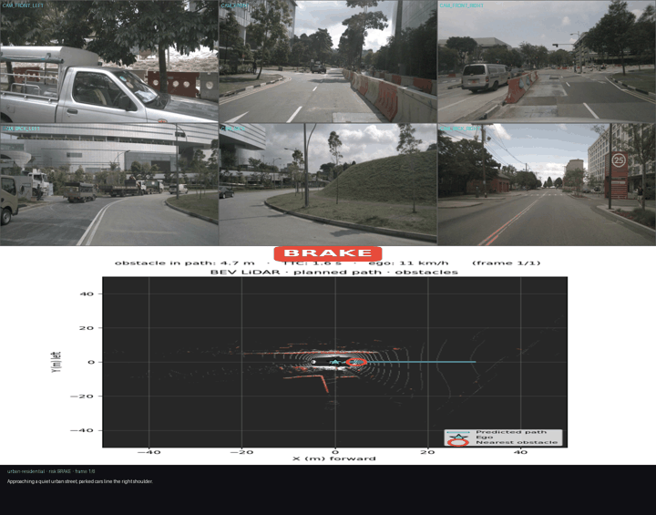
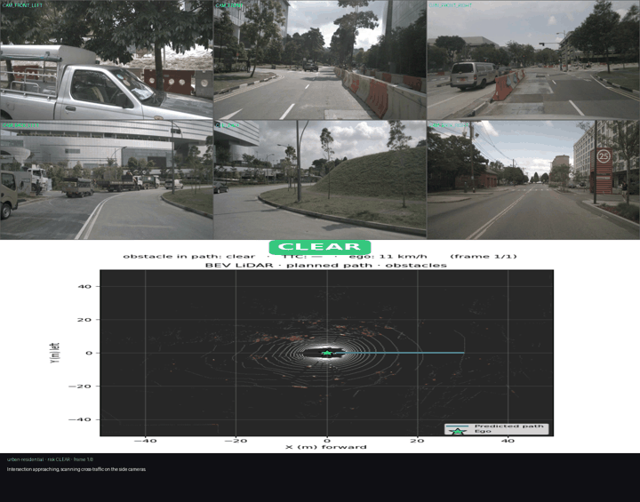
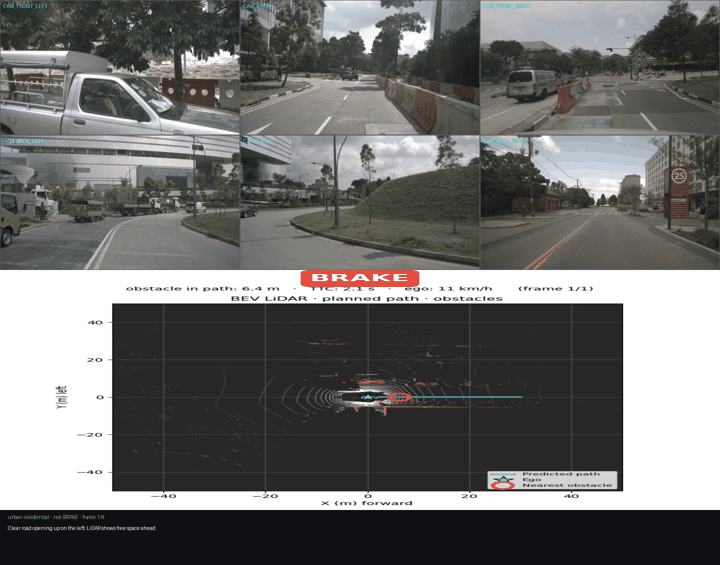

# Narrated scene demo

Generated by `scene_narrator.py` — a local VLM narrating each scene over the 6-camera surround view + LiDAR BEV.

## scene_01_clear  (CLEAR · urban-residential)

**Summary.** The ego vehicle drives through a quiet urban street lined with parked cars, slows for a nearby vehicle in-lane, then finds the path ahead clearing. Main risk is the close in-lane vehicle.

**Hazards:** parked vehicles narrowing lane, in-lane vehicle at close range, pedestrian near curb

**Live commentary:**

- Approaching a quiet urban street, parked cars line the right shoulder.
- A vehicle ahead sits close in our lane — easing off, watching the gap.
- Clear road opening up on the left; LiDAR shows free space ahead.
- Pedestrian near the right curb — holding speed, ready to slow.

## scene_02_caution  (CAUTION · urban-residential)

**Summary.** The ego vehicle drives through a quiet urban street lined with parked cars, slows for a nearby vehicle in-lane, then finds the path ahead clearing. Main risk is the close in-lane vehicle.

**Hazards:** parked vehicles narrowing lane, in-lane vehicle at close range, pedestrian near curb

**Live commentary:**

- Intersection approaching, scanning cross-traffic on the side cameras.
- Path ahead is clear; maintaining a steady cruise.
- Approaching a quiet urban street, parked cars line the right shoulder.
- A vehicle ahead sits close in our lane — easing off, watching the gap.

## scene_03_brake  (BRAKE · urban-residential)

**Summary.** The ego vehicle drives through a quiet urban street lined with parked cars, slows for a nearby vehicle in-lane, then finds the path ahead clearing. Main risk is the close in-lane vehicle.

**Hazards:** parked vehicles narrowing lane, in-lane vehicle at close range, pedestrian near curb

**Live commentary:**

- Clear road opening up on the left; LiDAR shows free space ahead.
- Pedestrian near the right curb — holding speed, ready to slow.
- Intersection approaching, scanning cross-traffic on the side cameras.
- Path ahead is clear; maintaining a steady cruise.